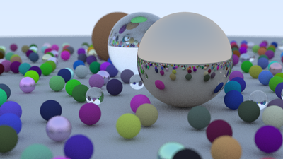

# ibrokhimn-rust

CPU ray tracer in Rust, following Peter Shirley's *Ray Tracing in One Weekend*.

- Language: Rust (edition 2021, tested on 1.75)
- Deps: `rand`, `rayon` (rayon is only used to spread scanlines across threads)

## Progress

- [x] Book 1: Ray Tracing in One Weekend (all chapters, final scene included)
- [ ] Book 2: The Next Week
- [ ] Book 3: The Rest of Your Life

## Build and run

```bash
cargo run --release
# or with args: width, samples per pixel, output path
cargo run --release -- 1200 500 output/image.ppm
```

Defaults are 400px wide, 50 spp, output goes to `output/image.ppm`.
Don't run it in debug mode, it's painfully slow.

The output is a plain PPM, open it with GIMP / IrfanView / any viewer that supports P3, or convert it:

```bash
convert output/image.ppm output/render.png   # imagemagick
```

## Layout

```
src/
├── main.rs        scene + camera setup
├── vec3.rs        Vec3 / Point3 / Color and random helpers
├── ray.rs
├── hittable.rs    Hittable trait, HitRecord, HittableList
├── sphere.rs
├── material.rs    Lambertian, Metal, Dielectric (enum, not trait objects)
└── camera.rs      camera, defocus blur, render loop
```

## Sample

600px, 100 spp, shrunk down for the repo:


